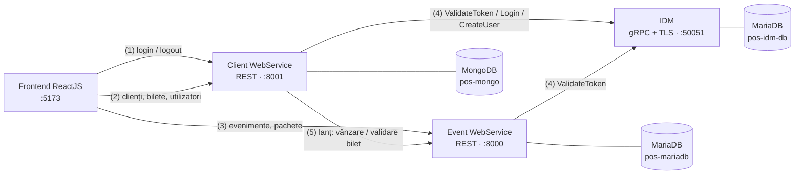
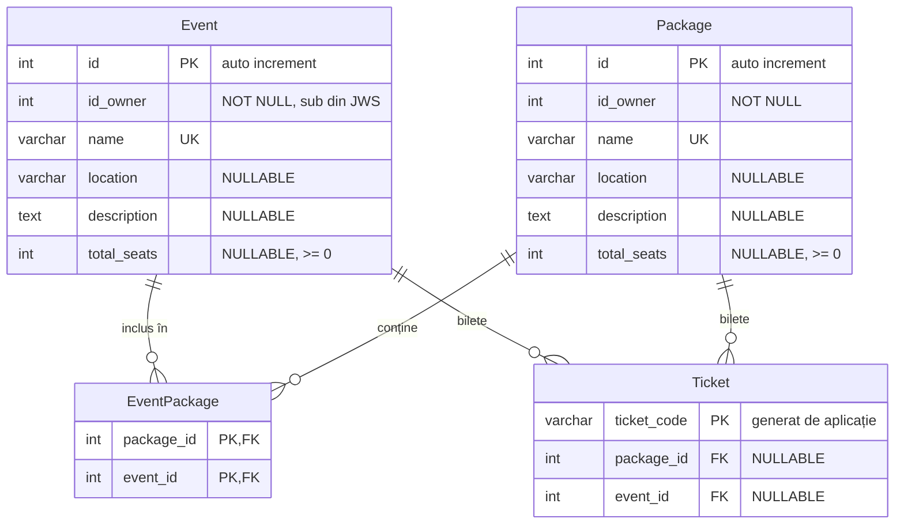
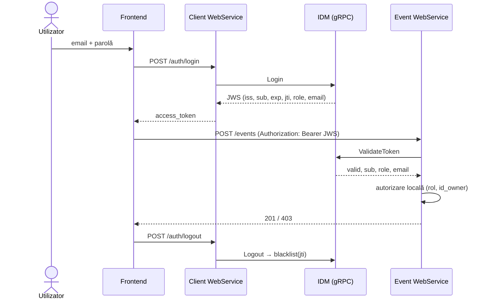

# Platforma de gestiune a evenimentelor

Aplicație orientată pe servicii pentru gestiunea unor evenimente artistice, a pachetelor de evenimente
și a biletelor vândute, dezvoltată pe parcursul laboratoarelor 1–6 de la *Programare Orientată pe Servicii*.

**Cuprins**

1. [Arhitectură](#1-arhitectură)
2. [Tehnologii](#2-tehnologii)
3. [Roluri și drepturi](#3-roluri-și-drepturi)
4. [Modelul de date](#4-modelul-de-date)
5. [Reguli de business](#5-reguli-de-business)
6. [API](#6-api)
7. [Autentificare și autorizare](#7-autentificare-și-autorizare)
8. [Securitate](#8-securitate)
9. [Configurare](#9-configurare)
10. [Rulare](#10-rulare)
11. [Frontend](#11-frontend)
12. [Exemple de utilizare](#12-exemple-de-utilizare)
13. [Structura proiectului](#13-structura-proiectului)
14. [Corespondența cu laboratoarele](#14-corespondența-cu-laboratoarele)
15. [Limitări cunoscute](#15-limitări-cunoscute)

---

## 1. Arhitectură



Interacțiunile numerotate corespund diagramei de componente din laboratorul 1:

| | Interacțiune |
| :--- | :--- |
| (1) | login / logout; Client WebService expune `/auth/*` ca fațadă REST peste IDM |
| (2), (3) | frontend-ul accesează resursele de date ale celor două servicii REST (cross-origin, CORS) |
| (4) | fiecare cerere protejată este validată prin `ValidateToken` (gRPC); serviciile primesc `sub`, `role`, `email` și fac autorizarea local |
| (5) | model *chain*: Client WebService apelează Event WebService pentru a vinde un bilet (`PUT /tickets/{cod}`), a-l valida (`GET /tickets/{cod}`) și a afla cumpărătorii evenimentelor unui owner; token-ul utilizatorului este transmis mai departe |

Fiecare bază de date rulează în containerul ei; doar serviciile sunt expuse pe porturi ale host-ului.

## 2. Tehnologii

| Componentă | Tehnologii |
| :--- | :--- |
| IDM | Python 3.12, gRPC 1.67 (unary RPC, TLS), PyJWT (HS256), bcrypt, PyMySQL |
| Event WebService | FastAPI, Pydantic v2, Peewee ORM, MariaDB 11 |
| Client WebService | FastAPI, Pydantic v2, PyMongo, MongoDB 8, httpx (apeluri către Event WebService) |
| Frontend | React 19, TypeScript, Vite, React Router |
| Infrastructură | Docker, Docker Compose, Docker secrets |

## 3. Roluri și drepturi

Un utilizator are un singur rol. Conturile de `owner-event` și `client` sunt create doar de administrator.

| Acțiune | vizitator | client | owner-event | admin |
| :--- | :---: | :---: | :---: | :---: |
| Vizualizare evenimente / pachete | ✔ | ✔ | ✔ | ✔ |
| Creare / editare / ștergere eveniment sau pachet | | | ✔ (doar proprii) | |
| Adăugare / scoatere evenimente dintr-un pachet | | | ✔ (pachete proprii) | |
| Vizualizare bilete vândute | | | ✔ (evenimente proprii) | |
| Vizualizare date publice ale cumpărătorilor | | | ✔ (evenimente proprii) | |
| Gestionare profil propriu | | ✔ | | |
| Cumpărare bilete | | ✔ | | |
| Vizualizare / validare bilete proprii | | ✔ | | |
| Creare / listare / ștergere utilizatori | | | | ✔ |
| Vizualizare / editare date clienți | | ✔ (doar propriile) | | ✔ |

Administratorul nu are acces la evenimente, pachete sau bilete (laboratorul 1, secțiunea 1.4).

## 4. Modelul de date

### MariaDB – Event WebService



| PDF (lab 1) | Implementare |
| :--- | :--- |
| `ID`, `ID_OWNER`, `nume`, `locatie`, `descriere`, `numarLocuri` | `id`, `id_owner`, `name`, `location`, `description`, `total_seats` |
| `COD`, `PachetID`, `EvenimentID` | `ticket_code`, `package_id`, `event_id` |

Un bilet este emis **fie** pentru un eveniment, **fie** pentru un pachet: constrângerea
`CHECK ((package_id IS NULL) <> (event_id IS NULL))` impune exact una dintre cele două chei străine.

### MongoDB – Client WebService (colecția `clients`)

Câmpurile opționale lipsesc din document dacă nu sunt completate.

```json
{
  "_id": "ObjectId",
  "email": "client@test.com",
  "first_name": "Ana",
  "last_name": "Pop",
  "public_name": true,
  "social": { "instagram": "@ana", "facebook": null, "tiktok": null, "public_social": false },
  "tickets": [
    { "code": "fe6a70d6…", "event_id": 1, "event_name": "Concert", "location": "Iasi" },
    { "code": "98c3e850…", "package_id": 2, "event_name": "Weekend Pass", "location": "Iasi",
      "events": [ { "id": 1, "name": "Concert", "location": "Iasi" } ] }
  ]
}
```

`email` leagă documentul de utilizatorul din IDM. Flag-urile `public_name` / `public_social` decid ce vede
un owner-event despre cumpărătorii evenimentelor sale. Biletele sunt păstrate în format lung
(nume, locație, evenimentele incluse în pachet).

### MariaDB – IDM (tabela `users`)

| Câmp | Tip | Constrângeri |
| :--- | :--- | :--- |
| `id` | INT | PK, auto increment |
| `email` | VARCHAR(255) | UNIQUE, NOT NULL (username) |
| `password_hash` | VARCHAR(255) | NOT NULL (bcrypt) |
| `role` | ENUM(`admin`, `owner-event`, `client`) | NOT NULL |

## 5. Reguli de business

Cerințele din laboratorul 1, secțiunea 1.1:

| Regulă | Unde | Eroare |
| :--- | :--- | :--- |
| Biletele vândute nu pot depăși locurile disponibile | verificare în tranzacție, cu `SELECT … FOR UPDATE` pe rândul evenimentului / pachetului | 409 |
| Nu se vând bilete dacă `total_seats` nu este setat | `TicketsService._capacity_error` | 409 |
| Nu se vând bilete pentru un pachet fără evenimente | `TicketsService._capacity_error` | 409 |
| Locurile unui pachet ≤ minimul locurilor evenimentelor incluse | la adăugarea unui eveniment, la editarea pachetului și la editarea evenimentului | 409 |
| Numărul de locuri nu se mai poate modifica după primul bilet vândut | editare eveniment / pachet | 409 |
| Componența unui pachet nu se mai poate modifica după prima vânzare | adăugare / scoatere eveniment | 409 |
| Nu se pot șterge evenimente / pachete cu bilete vândute | ștergere | 409 |
| Un owner gestionează doar resursele create de el (`id_owner` = `sub` din JWS) | toate operațiile de scriere | 403 |
| Un client poate cumpăra mai multe bilete la același eveniment | `POST /api/clients/me/tickets` | – |

## 6. API

Documentația OpenAPI completă (generată *code-first*):

| Serviciu | Swagger UI | JSON |
| :--- | :--- | :--- |
| Event WebService | <http://localhost:8000/docs> | <http://localhost:8000/openapi.json> |
| Client WebService | <http://localhost:8001/docs> | <http://localhost:8001/openapi.json> |

Rutele protejate apar în OpenAPI cu schema de securitate `HTTPBearer`.

### Event WebService – `http://localhost:8000/api/event-manager`

| Metodă | Rută | Acces | Descriere |
| :--- | :--- | :--- | :--- |
| GET | `/events` | public | listă paginată; filtre `name`, `location` (potrivire parțială), `available_tickets`, `id_owner` |
| POST | `/events` | owner-event | creează un eveniment (201) |
| GET | `/events/{id}` | public | detalii eveniment |
| PUT | `/events/{id}` | owner-event (owner) | creează la id-ul dat (201) sau înlocuiește (204) |
| DELETE | `/events/{id}` | owner-event (owner) | șterge (204); 409 dacă există bilete |
| GET | `/events/{id}/event-packets` | public | pachetele care conțin evenimentul |
| PUT / DELETE | `/events/{id}/event-packets/{pid}` | owner-event (owner pachet) | include / scoate evenimentul din pachet |
| GET / POST | `/events/{id}/tickets` | owner-event (owner) | biletele vândute / emite un bilet |
| GET / DELETE | `/events/{id}/tickets/{cod}` | owner-event (owner) | un bilet / invalidează biletul |
| GET | `/event-packets` | public | listă paginată; filtre `name`, `location`, `event_name`, `type` (în descriere), `available_tickets`, `id_owner` |
| POST | `/event-packets` | owner-event | creează un pachet |
| GET | `/event-packets/{id}` | public | detalii pachet |
| PUT / DELETE | `/event-packets/{id}` | owner-event (owner) | creează sau înlocuiește / șterge |
| GET | `/event-packets/{id}/events` | public | evenimentele din pachet |
| PUT / DELETE | `/event-packets/{id}/events/{eid}` | owner-event (owner) | include / scoate un eveniment |
| GET / POST | `/event-packets/{id}/tickets` | owner-event (owner) | biletele vândute / emite un bilet |
| GET / DELETE | `/event-packets/{id}/tickets/{cod}` | owner-event (owner) | un bilet / invalidează biletul |
| GET | `/tickets` | owner-event | biletele pentru evenimentele / pachetele proprii |
| POST | `/tickets` | owner-event | emite un bilet (cod generat de server) |
| PUT | `/tickets/{cod}` | client, owner-event | vinde un bilet cu un cod ales de client (folosit de Client WebService) |
| GET | `/tickets/{cod}` | client, owner-event | validarea unui bilet (apel în lanț) |
| DELETE | `/tickets/{cod}` | owner-event (owner) | invalidează biletul |

### Client WebService – `http://localhost:8001`

| Metodă | Rută | Acces | Descriere |
| :--- | :--- | :--- | :--- |
| POST | `/auth/login` | public | credențiale → JWS |
| POST | `/auth/logout` | autentificat | pune token-ul în blacklist (204) |
| GET | `/auth/me` | autentificat | `sub`, `role`, `email` din token |
| GET / POST | `/api/users` | admin | listează / creează conturi `owner-event` sau `client` |
| DELETE | `/api/users/{id}` | admin | șterge contul (și documentul clientului) |
| GET | `/api/clients` | admin | listă paginată; filtru `email` |
| POST | `/api/clients` | admin, client (doar propriul email) | creează profilul |
| GET / PUT | `/api/clients/me` | client | profilul propriu (PUT → 204) |
| GET / POST | `/api/clients/me/tickets` | client | biletele proprii / cumpără un bilet |
| GET | `/api/clients/buyers` | owner-event | datele publice ale cumpărătorilor; filtre `event_id`, `package_id` |
| GET / PUT | `/api/clients/{id}` | admin, client (propriul) | citire / actualizare |
| DELETE | `/api/clients/{id}` | admin | șterge documentul |
| GET / POST | `/api/clients/{id}/tickets` | client (propriul) | biletele / cumpără |
| GET | `/api/clients/{id}/tickets/{cod}` | client (propriul), owner-event | validează biletul și întoarce evenimentul / pachetul |

### IDM – gRPC `localhost:50051` (TLS)

Definit în `backend/idm-service/proto/idm.proto` (copii identice în celelalte servicii).

| RPC | Acces | Descriere |
| :--- | :--- | :--- |
| `Login(username, password)` | public | întoarce JWS-ul |
| `ValidateToken(token)` | public | `valid`, `sub`, `role`, `email`, `message` (`ok` / `expired` / `invalid` / `blacklisted`) |
| `Logout(token)` | Bearer | pune token-ul în blacklist |
| `CreateUser(email, password, role)` | admin | doar rolurile `owner-event` și `client` |
| `ListUsers()` / `DeleteUser(id)` | admin | |

Metodele protejate primesc token-ul în metadata `authorization: Bearer <JWS>`, verificat de `AuthInterceptor`.

### Convenții REST

- **HATEOAS**: fiecare reprezentare conține `_links` cu cel puțin `self` și `parent` (și `type` = metoda HTTP).
  Listele au `next` / `prev`. Evenimentele și pachetele conțin și legături către Client WebService
  (`client-profile`, `client-tickets`, `buy-ticket`), conform laboratorului 3.
- **Paginare**: `?page=` (de la 1) și `?items_per_page=` (implicit 10, maxim 100).
- **Coduri de răspuns**:

| Cod | Când |
| :--- | :--- |
| 200 | citire reușită |
| 201 | resursă creată (POST sau PUT pe un id nou), cu reprezentarea resursei |
| 204 | PUT care înlocuiește o resursă existentă, DELETE, logout |
| 401 | lipsește header-ul `Authorization`, sau token invalid / expirat / revocat |
| 403 | rolul nu are dreptul sau resursa aparține altui utilizator |
| 404 | resursa nu există |
| 409 | conflict: nume duplicat, locuri epuizate, bilete deja vândute etc. |
| 415 | reprezentare neconformă: lipsește un câmp obligatoriu, body-ul nu este obiect JSON, `Content-Type` greșit |
| 422 | reprezentare conformă, dar cu valori nepermise (email invalid, locuri negative, parametri de query greșiți) |
| 503 | serviciul IDM nu este disponibil |

## 7. Autentificare și autorizare



**JWS** (HS256, valabil o oră), claim-uri:

| Claim | Valoare |
| :--- | :--- |
| `iss` | URL-ul serviciului emitent (`IDM_JWT_ISSUER`, implicit `https://pos-idm-service:50051`) |
| `sub` | id-ul utilizatorului; devine `id_owner` pentru evenimente și pachete |
| `exp` | expirare (`IDM_JWT_TTL_SECONDS`, implicit 3600) |
| `jti` | UUID, folosit de blacklist |
| `role` | `admin` / `owner-event` / `client` |
| `email` | legătura cu documentul clientului din MongoDB |

**Blacklist** (în memorie): token-urile delogate și cele expirate sunt reținute după `jti`. Token-urile cu
semnătura invalidă sunt reținute după hash-ul SHA-256 al token-ului, nu după `jti`-ul pe care îl declară,
astfel încât un token falsificat nu poate revoca token-ul valid al altui utilizator.

## 8. Securitate

| Măsură | Detalii |
| :--- | :--- |
| Parole | bcrypt cu salt; nu sunt stocate și nu sunt întoarse în clar |
| Token-uri | semnate HS256; secretul este cunoscut doar de IDM, celelalte servicii validează prin gRPC |
| Revocare | logout real (blacklist pe server), nu doar ștergerea token-ului din browser |
| Canalul IDM | gRPC peste TLS; certificat cu SAN pentru `pos-idm-service`, `idm-service`, `localhost` |
| Autorizare | rol + proprietar (`id_owner` din token, nu din body), verificată în fiecare serviciu; testată pentru IDOR (owner A nu poate modifica resursele owner-ului B) |
| Principiul privilegiului minim | adminul nu vede date de business; owner-ul vede doar câmpurile marcate publice ale cumpărătorilor |
| Baze de date | neexpuse pe host; utilizatori separați per bază (MongoDB: `userAdminAnyDatabase`, `dbOwner`, `readWrite`; aplicația folosește doar `readWrite`) |
| Secrete | Docker secrets din `./secrets/` (git-ignored), generate aleator de `scripts/setup.*` |
| CORS | origini explicite (`CORS_ORIGINS`), metode și header-e listate; fără cookie-uri (`allow_credentials=false`) |
| Validare intrări | Pydantic pe toate body-urile; ID-uri MongoDB invalide → 404; filtrul `email` este escapat (fără injecție de regex) |
| Concurență | vânzarea biletelor rulează într-o tranzacție cu blocarea rândului (`SELECT … FOR UPDATE`), deci nu se pot depăși locurile |
| Containere | serviciile REST rulează cu un utilizator non-root; versiunile dependențelor sunt fixate |

Limitările de securitate sunt descrise în [secțiunea 15](#15-limitări-cunoscute).

## 9. Configurare

### `.env` (din `.env.example`)

| Variabilă | Rol |
| :--- | :--- |
| `EVENTS_DB_CONTAINER`, `CLIENTS_DB_CONTAINER`, `IDM_DB_CONTAINER` | numele simbolice ale containerelor de baze de date (laboratorul 5) |
| `DB_NAME`, `DB_USER`, `DB_ADMIN_USER` | baza MariaDB a Event WebService |
| `MONGO_ADMIN_USER`, `MONGO_USER_ADMIN_USER`, `MONGO_DB_OWNER_USER`, `MONGO_APP_USER`, `MONGO_DB_NAME`, `MONGO_CLIENTS_COLLECTION` | MongoDB |
| `IDM_DB_NAME`, `IDM_DB_USER` | baza MariaDB a IDM |
| `IDM_JWT_SECRET`, `IDM_JWT_ISSUER` | semnarea token-urilor |
| `EVENTS_PUBLIC_URL`, `CLIENTS_PUBLIC_URL` | adrese folosite în link-urile HATEOAS dintre servicii |
| `CORS_ORIGINS` | originile web acceptate (aplicația React) |

### `secrets/` (un fișier per parolă, fără newline)

`db_root_pass`, `db_user_pass`, `db_admin_pass`, `mongo_admin_pass`, `mongo_user_admin_pass`,
`mongo_db_owner_pass`, `mongo_app_pass`, `idm_db_root_pass`, `idm_db_pass` (toate `.txt`).

### `certs/`

`idm.crt` și `idm.key`: certificat auto-semnat pentru serverul gRPC, generat din `certs/idm_openssl.cnf`.

## 10. Rulare

### Pregătire (o singură dată)

```powershell
powershell -ExecutionPolicy Bypass -File scripts\setup.ps1   # Windows
./scripts/setup.sh                                           # Linux / macOS / Git Bash
```

Scriptul creează `.env`, parolele din `secrets/` (doar pe cele lipsă) și certificatul IDM
(openssl rulează într-un container `alpine/openssl`, deci nu trebuie instalat).

### Docker Compose

```bash
docker compose up --build
docker compose logs -f            # log-urile tuturor serviciilor
docker compose down               # oprire
docker compose down -v            # oprire + ștergerea datelor
```

Ordinea de pornire este impusă prin `depends_on` cu `condition: service_healthy`: bazele de date, apoi IDM,
apoi Event WebService și apoi Client WebService. Scripturile de inițializare MariaDB / MongoDB rulează doar
pe un volum gol; după o schimbare de parole sau de utilizatori este necesar `docker compose down -v`.

### Manual (`docker network` + `docker run`)

Exemplu PowerShell, din rădăcina proiectului, după `scripts\setup.ps1`:

```powershell
Get-Content .env | Where-Object { $_ -match '^\w+=' } | ForEach-Object { $k,$v = $_ -split '=',2; Set-Item "env:$k" $v }
$S = "${PWD}\secrets"; $C = "${PWD}\certs"

# 1. rețeaua virtuală
docker network create pos-network

# 2. bazele de date (primele)
docker run -d --name $env:IDM_DB_CONTAINER --network pos-network `
  -e MARIADB_DATABASE=$env:IDM_DB_NAME -e MARIADB_USER=$env:IDM_DB_USER `
  -e MARIADB_PASSWORD_FILE=/run/secrets/idm_db_pass -e MARIADB_ROOT_PASSWORD_FILE=/run/secrets/idm_db_root_pass `
  -v "${S}:/run/secrets:ro" mariadb:11

docker run -d --name $env:EVENTS_DB_CONTAINER --network pos-network `
  -e MYSQL_DATABASE=$env:DB_NAME -e MYSQL_USER=$env:DB_USER -e DB_NAME=$env:DB_NAME -e DB_USER=$env:DB_USER -e DB_ADMIN_USER=$env:DB_ADMIN_USER `
  -e MYSQL_PASSWORD_FILE=/run/secrets/db_user_pass -e MYSQL_ROOT_PASSWORD_FILE=/run/secrets/db_root_pass `
  -v "${S}:/run/secrets:ro" -v "${PWD}\backend\mariadb-init:/docker-entrypoint-initdb.d:ro" mariadb:11

docker run -d --name $env:CLIENTS_DB_CONTAINER --network pos-network `
  -e MONGO_INITDB_ROOT_USERNAME=$env:MONGO_ADMIN_USER -e MONGO_INITDB_ROOT_PASSWORD_FILE=/run/secrets/mongo_admin_pass `
  -e MONGO_DB_NAME=$env:MONGO_DB_NAME -e MONGO_USER_ADMIN_USER=$env:MONGO_USER_ADMIN_USER -e MONGO_DB_OWNER_USER=$env:MONGO_DB_OWNER_USER -e MONGO_APP_USER=$env:MONGO_APP_USER `
  -v "${S}:/run/secrets:ro" -v "${PWD}\backend\mongo-init:/docker-entrypoint-initdb.d:ro" mongo:8 mongod --auth

# 3. imaginile serviciilor
docker build -t pos-idm ./backend/idm-service
docker build -t pos-events ./backend/events-manager-service
docker build -t pos-clients ./backend/clients-service

# 4. serviciile (după ce bazele de date au pornit)
docker run -d --name pos-idm-service --network pos-network -p 50051:50051 `
  -e IDM_DB_HOST=$env:IDM_DB_CONTAINER -e IDM_DB_NAME=$env:IDM_DB_NAME -e IDM_DB_USER=$env:IDM_DB_USER -e IDM_DB_PASS_FILE=/run/secrets/idm_db_pass `
  -e IDM_JWT_SECRET=$env:IDM_JWT_SECRET -e IDM_JWT_ISSUER=$env:IDM_JWT_ISSUER -e IDM_TLS_CERT=/certs/idm.crt -e IDM_TLS_KEY=/certs/idm.key `
  -v "${S}:/run/secrets:ro" -v "${C}:/certs:ro" pos-idm

docker run -d --name pos-events-manager --network pos-network -p 8000:8000 `
  -e DB_HOST=$env:EVENTS_DB_CONTAINER -e DB_NAME=$env:DB_NAME -e DB_USER=$env:DB_USER -e DB_PASS_FILE=/run/secrets/db_user_pass `
  -e IDM_GRPC_HOST=pos-idm-service -e IDM_TLS_ROOT_CERT=/certs/idm.crt `
  -e CLIENTS_PUBLIC_URL=$env:CLIENTS_PUBLIC_URL -e CORS_ORIGINS=$env:CORS_ORIGINS `
  -v "${S}:/run/secrets:ro" -v "${C}:/certs:ro" pos-events

docker run -d --name pos-clients --network pos-network -p 8001:8000 `
  -e MONGO_HOST=$env:CLIENTS_DB_CONTAINER -e MONGO_DB_NAME=$env:MONGO_DB_NAME -e MONGO_APP_USER=$env:MONGO_APP_USER -e MONGO_APP_PASS_FILE=/run/secrets/mongo_app_pass `
  -e MONGO_CLIENTS_COLLECTION=$env:MONGO_CLIENTS_COLLECTION -e IDM_GRPC_HOST=pos-idm-service -e IDM_TLS_ROOT_CERT=/certs/idm.crt `
  -e DATA_SERVICE_URL=http://pos-events-manager:8000 -e EVENTS_PUBLIC_URL=$env:EVENTS_PUBLIC_URL -e CORS_ORIGINS=$env:CORS_ORIGINS `
  -v "${S}:/run/secrets:ro" -v "${C}:/certs:ro" pos-clients
```

Oprire: `docker rm -f pos-clients pos-events-manager pos-idm-service pos-mongo pos-mariadb pos-idm-db; docker network rm pos-network`.

### Conturi de test

| Email | Parolă | Rol |
| :--- | :--- | :--- |
| `admin@test.com` | `admin123` | admin |
| `owner@test.com` | `owner123` | owner-event |
| `client@test.com` | `client123` | client |

Parolele conturilor de test se pot schimba prin `IDM_SEED_ADMIN_PASS`, `IDM_SEED_OWNER_PASS`,
`IDM_SEED_CLIENT_PASS` (sunt hash-uite la prima autentificare). Clientul de test își creează profilul din
pagina **Profile**; conturile create de admin primesc automat documentul MongoDB.

## 11. Frontend

```bash
cd frontend/pos-web
cp .env.example .env      # VITE_AUTH_API, VITE_CLIENTS_API, VITE_EVENTS_API
npm install
npm run dev               # http://localhost:5173
```

| Rol | Pagini |
| :--- | :--- |
| vizitator | **Events**, **Packages**: căutare (nume, locație, bilete disponibile, eveniment inclus, tip) și paginare prin API |
| client | Events / Packages cu **Buy**, **My tickets** (cu validare), **Profile** (date personale + flag-uri de vizibilitate) |
| owner-event | **My events**, **My packages** (creare / editare / ștergere, evenimente din pachet, bilete vândute), **Buyers**, **All events / packages** |
| admin | **Users** (creare / ștergere conturi), **Clients** |

Comunicarea cu API-urile se face asincron în `useEffect`. Componentele reutilizabile primesc date prin
`props`: `EventForm` (comun evenimentelor și pachetelor), `Pager`, `TicketsList`. Token-ul este trimis în
header-ul `Authorization`, iar logout-ul îl invalidează și pe server.

## 12. Exemple de utilizare

```bash
# login
TOKEN=$(curl -s -X POST http://localhost:8001/auth/login -H "Content-Type: application/json" \
  -d '{"email":"owner@test.com","password":"owner123"}' | jq -r .access_token)

# owner: creează un eveniment și un pachet, apoi include evenimentul în pachet
curl -X POST http://localhost:8000/api/event-manager/events -H "Authorization: Bearer $TOKEN" \
  -H "Content-Type: application/json" -d '{"name":"Concert","location":"Iasi","total_seats":100}'
curl -X POST http://localhost:8000/api/event-manager/event-packets -H "Authorization: Bearer $TOKEN" \
  -H "Content-Type: application/json" -d '{"name":"Weekend","description":"concert","total_seats":50}'
curl -X PUT http://localhost:8000/api/event-manager/event-packets/1/events/1 -H "Authorization: Bearer $TOKEN"

# vizitator: căutare publică
curl "http://localhost:8000/api/event-manager/events?location=ias&available_tickets=10&page=1&items_per_page=5"

# client: cumpără un bilet (apel în lanț către Event WebService)
CTOKEN=$(curl -s -X POST http://localhost:8001/auth/login -H "Content-Type: application/json" \
  -d '{"email":"client@test.com","password":"client123"}' | jq -r .access_token)
curl -X POST http://localhost:8001/api/clients -H "Authorization: Bearer $CTOKEN" \
  -H "Content-Type: application/json" -d '{"email":"client@test.com","first_name":"Ana","public_name":true}'
curl -X POST http://localhost:8001/api/clients/me/tickets -H "Authorization: Bearer $CTOKEN" \
  -H "Content-Type: application/json" -d '{"event_id":1}'

# logout: token-ul nu mai este acceptat (401)
curl -X POST http://localhost:8001/auth/logout -H "Authorization: Bearer $CTOKEN"
```

Serviciul gRPC poate fi testat direct cu `backend/idm-service/app/client_test.py`
(`IDM_TARGET=localhost:50051`, `IDM_CA_CERT=certs/idm.crt`).

## 13. Structura proiectului

```
.
├── backend/
│   ├── idm-service/              # gRPC: login, validare, logout, utilizatori
│   │   ├── proto/idm.proto
│   │   └── app/                  # server.py, auth_interceptor.py, jwt_utils.py, token_blacklist.py, db.py
│   ├── events-manager-service/   # REST + MariaDB
│   │   └── app/
│   │       ├── controllers/      # rute: events, packages (event-packets), tickets
│   │       ├── services/         # reguli de business
│   │       ├── repositories/     # acces la date (Peewee)
│   │       ├── dtos/             # modele Pydantic (request / response)
│   │       ├── database/         # modele, conexiune, inițializare
│   │       ├── security/         # validare token, roluri, proprietar
│   │       └── links.py          # link-uri HATEOAS către Client WebService
│   ├── clients-service/          # REST + MongoDB, /auth/*, /api/users
│   │   └── app/
│   │       ├── controllers/      # auth, users, clients
│   │       ├── services/         # bilete, cumpărători, apeluri în lanț
│   │       ├── repositories/     # acces MongoDB
│   │       ├── integrations/     # client gRPC IDM, client HTTP Event WebService
│   │       └── security/
│   ├── mariadb-init/             # utilizatori MariaDB
│   └── mongo-init/               # utilizatori MongoDB
├── frontend/pos-web/             # React + TypeScript (Vite)
│   └── src/{api,auth,components,pages,router,ui}
├── certs/                        # configurare openssl (cheile generate nu intră în git)
├── scripts/setup.ps1, setup.sh   # .env, secrete, certificat
├── docker-compose.yml
└── .env.example
```

Fiecare serviciu REST urmează modelul MVC din laboratorul 2: *Model* (`database`, `repositories`),
*Controller* (`controllers`, `services`), *View* (`dtos`, serializare JSON).

## 14. Corespondența cu laboratoarele

| Laborator | Cerință | Implementare |
| :--- | :--- | :--- |
| 1 – Descriere și proiectare | modelul de date, reguli de business, roluri | secțiunile 3–5 |
| 2 – REST pentru SQL | CRUD, rute de navigare, paginare, căutare, HATEOAS, OpenAPI | `events-manager-service` |
| 3 – REST pentru NoSQL | colecția de clienți, securizare MongoDB, apeluri în lanț, link-uri către clienți | `clients-service`, `mongo-init.sh`, `links.py` |
| 4 – JWT / gRPC | IDM gRPC, JWS cu claim-urile cerute, blacklist, 401 / 403, OpenAPI cu rute protejate | `idm-service`, `security/` |
| 5 – Docker | containere separate pentru baze de date și servicii, rețea, nume simbolice prin env, Compose | `docker-compose.yml`, secțiunea 10 |
| 6 – ReactJS | login / logout, vizitator, owner-event, client, CORS | `frontend/pos-web`, `CORS_ORIGINS` |

## 15. Limitări cunoscute

| Limitare | Impact | Posibilă îmbunătățire |
| :--- | :--- | :--- |
| Blacklist-ul IDM este în memorie | la repornirea IDM, token-urile revocate redevin valide până la expirare (maxim o oră) | Redis sau o tabelă în baza IDM |
| Token-ul este păstrat în `localStorage` | expus în cazul unui atac XSS | cookie `HttpOnly` + `SameSite` (recomandarea din laboratorul 4) |
| Comunicarea REST este HTTP | token-urile circulă necriptat în afara mașinii locale | reverse proxy cu TLS |
| gRPC fără autentificare mutuală (mTLS) | orice client din rețea poate apela `Login` / `ValidateToken` | certificate de client |
| `Login` nu are limitare a numărului de încercări | brute force pe parole | rate limiting / blocare temporară |
| Un client poate valida orice bilet al cărui cod îl cunoaște (`GET /tickets/{cod}`) | codul (32 caractere hex) funcționează ca un *capability*; Client WebService verifică întâi că biletul este al clientului | legarea biletului de `sub` în Event WebService |
| Utilizatorul aplicației MariaDB primește `ALL` pe baza de date (de la imaginea oficială), nu doar `SELECT/INSERT/UPDATE/DELETE` | privilegii mai mari decât necesar | utilizator dedicat pentru migrări |
| Serviciul IDM rulează ca root în container | | utilizator non-root cu acces la cheia TLS |
| Vânzarea unui bilet de pachet nu scade locurile evenimentelor incluse | interpretare: locurile pachetului sunt o alocare separată, limitată de minimul locurilor evenimentelor | |
